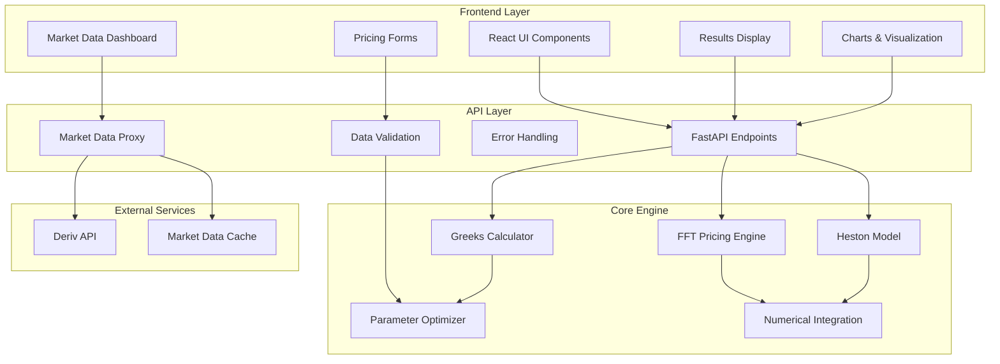

# Design Document

## Overview

This design document outlines the architecture and implementation approach for enhancing the derivatives pricing engine with advanced pricing models, comprehensive Greeks calculations, a complete frontend interface, and real-time market data integration. The enhancements build upon the existing Rust/Python hybrid architecture while maintaining high performance and numerical accuracy.

The system will provide production-ready option pricing capabilities comparable to institutional trading platforms, with support for multiple pricing models, risk analytics, and real-time market data integration through the Deriv API.

## Architecture

The enhanced system maintains the three-tier architecture with significant expansions:



## Components and Interfaces

### 1. Enhanced FFT Pricing Engine

**Purpose**: Provide numerically stable and accurate FFT-based option pricing using the Carr-Madan methodology.

**Key Components**:
- **Parameter Optimizer**: Automatically selects optimal alpha, n, and delta_v parameters
- **Stability Checker**: Validates parameter combinations for numerical stability
- **Error Handler**: Provides diagnostic information for failed calculations

**Implementation Strategy**:
Based on research from academic sources, the FFT pricing stability issues stem from:
1. **Damping Parameter Selection**: Alpha must be chosen to ensure integrand decay
2. **Grid Resolution**: Balance between accuracy and computational efficiency  
3. **Characteristic Function Evaluation**: Proper complex arithmetic handling

**Parameter Optimization Algorithm**:
```rust
struct FFTParameters {
    alpha: f64,      // Damping factor (1.0 to 2.0 range)
    n: usize,        // Grid points (power of 2, 2048-8192)
    delta_v: f64,    // Frequency step (0.005 to 0.05)
}

impl FFTParameters {
    fn optimize_for_stability(s: f64, k: f64, tau: f64, sigma: f64) -> Self {
        // Use adaptive algorithm based on option moneyness and time to expiration
        let moneyness = (s / k).ln();
        let alpha = if tau < 0.25 { 1.5 } else { 1.2 };
        let n = if moneyness.abs() > 0.2 { 4096 } else { 2048 };
        let delta_v = 0.01 * (1.0 + sigma);
        
        Self { alpha, n, delta_v }
    }
}
```

**Interface**:
```rust
pub struct FFTPricingEngine {
    pub fn price_call_optimized(s: f64, k: f64, tau: f64, r: f64, sigma: f64) -> Result<f64, FFTError>;
    pub fn price_put_optimized(s: f64, k: f64, tau: f64, r: f64, sigma: f64) -> Result<f64, FFTError>;
    pub fn validate_parameters(params: &FFTParameters) -> Result<(), ValidationError>;
}
```

### 2. Heston Model Implementation

**Purpose**: Provide stochastic volatility option pricing with mean-reverting volatility dynamics.

**Mathematical Foundation**:
The Heston model uses the characteristic function approach with numerical integration:

```
C(S,V,t) = S*P1 - K*exp(-r*τ)*P2
```

Where P1 and P2 are probabilities computed via Fourier inversion of the characteristic function.

**Key Components**:
- **Characteristic Function**: Already implemented, needs integration wrapper
- **Numerical Integrator**: Adaptive quadrature for Fourier integrals
- **Parameter Validator**: Ensures Feller condition compliance
- **Calibration Engine**: Fit model parameters to market data

**Implementation Strategy**:
```rust
pub struct HestonModel {
    pub v0: f64,      // Initial variance
    pub theta: f64,   // Long-term variance
    pub kappa: f64,   // Mean reversion speed
    pub sigma_v: f64, // Volatility of volatility
    pub rho: f64,     // Correlation
}

impl HestonModel {
    pub fn validate_feller_condition(&self) -> Result<(), HestonError> {
        if 2.0 * self.kappa * self.theta <= self.sigma_v.powi(2) {
            Err(HestonError::FellerConditionViolated)
        } else {
            Ok(())
        }
    }
    
    pub fn price_call(&self, s: f64, k: f64, tau: f64, r: f64) -> Result<f64, HestonError> {
        // Implement numerical integration of characteristic function
        let integrand = |u: f64| -> Complex<f64> {
            let cf = self.cf_heston(u - Complex::i(), s, tau, r);
            cf / (Complex::i() * u)
        };
        
        let integral = adaptive_quadrature(integrand, 0.0, 100.0, 1e-8)?;
        Ok(s - k * (-r * tau).exp() * integral.re / PI)
    }
}
```

### 3. Greeks Calculation System

**Purpose**: Provide comprehensive risk sensitivities for all pricing models using both analytical and numerical methods.

**Greeks Definitions**:
- **Delta (Δ)**: ∂V/∂S - Price sensitivity to underlying asset price
- **Gamma (Γ)**: ∂²V/∂S² - Rate of change of Delta
- **Theta (Θ)**: ∂V/∂t - Time decay
- **Vega (ν)**: ∂V/∂σ - Volatility sensitivity  
- **Rho (ρ)**: ∂V/∂r - Interest rate sensitivity

**Implementation Strategy**:
```rust
pub struct GreeksCalculator {
    pub fn calculate_all_greeks<P: PricingModel>(
        model: &P,
        params: &OptionParameters
    ) -> GreeksResult {
        GreeksResult {
            delta: self.calculate_delta(model, params),
            gamma: self.calculate_gamma(model, params),
            theta: self.calculate_theta(model, params),
            vega: self.calculate_vega(model, params),
            rho: self.calculate_rho(model, params),
        }
    }
    
    fn calculate_delta<P: PricingModel>(&self, model: &P, params: &OptionParameters) -> f64 {
        let h = params.s * 0.01; // 1% bump
        let price_up = model.price_call(params.s + h, params.k, params.tau, params.r, params.sigma);
        let price_down = model.price_call(params.s - h, params.k, params.tau, params.r, params.sigma);
        (price_up - price_down) / (2.0 * h)
    }
}
```

**Analytical Greeks for Black-Scholes**:
For improved accuracy, implement analytical formulas where available:
```rust
impl BlackScholesGreeks {
    pub fn delta_call_analytical(s: f64, k: f64, tau: f64, r: f64, sigma: f64) -> f64 {
        let d1 = self.calculate_d1(s, k, tau, r, sigma);
        normal_cdf(d1)
    }
    
    pub fn gamma_analytical(s: f64, k: f64, tau: f64, r: f64, sigma: f64) -> f64 {
        let d1 = self.calculate_d1(s, k, tau, r, sigma);
        normal_pdf(d1) / (s * sigma * tau.sqrt())
    }
}
```

### 4. Frontend Component Architecture

**Purpose**: Provide an intuitive, responsive web interface for option pricing, analysis, and market data visualization.

**Component Hierarchy**:
```typescript
interface PricingEngineApp {
  components: {
    Header: NavigationComponent;
    PricingWorkspace: {
      ModelSelector: ModelSelectionComponent;
      ParameterInput: ParameterFormComponent;
      ResultsDisplay: ResultsTableComponent;
      GreeksDisplay: GreeksVisualizationComponent;
    };
    MarketDataDashboard: {
      OptionChain: OptionChainComponent;
      VolatilitySurface: VolSurfaceChartComponent;
      RealTimeData: MarketDataStreamComponent;
    };
    ComparisonTools: {
      ModelComparison: ComparisonTableComponent;
      SensitivityAnalysis: SensitivityChartComponent;
    };
  };
}
```

**Key Features**:
- **Real-time Validation**: Input validation with immediate feedback
- **Interactive Charts**: Plotly.js integration for volatility surfaces and Greeks
- **Responsive Design**: Mobile-first approach with Tailwind CSS
- **Export Functionality**: CSV/JSON export for results and analysis

**State Management**:
```typescript
interface AppState {
  pricingParameters: OptionParameters;
  selectedModels: PricingModel[];
  results: PricingResults[];
  marketData: MarketDataState;
  ui: UIState;
}

const usePricingEngine = () => {
  const [state, dispatch] = useReducer(pricingReducer, initialState);
  
  const calculatePrices = async (params: OptionParameters) => {
    dispatch({ type: 'CALCULATION_START' });
    try {
      const results = await api.calculatePrices(params);
      dispatch({ type: 'CALCULATION_SUCCESS', payload: results });
    } catch (error) {
      dispatch({ type: 'CALCULATION_ERROR', payload: error });
    }
  };
  
  return { state, calculatePrices };
};
```

### 5. Deriv API Integration

**Purpose**: Provide real-time market data integration for practical trading applications.

**Integration Architecture**:
```python
class DerivAPIClient:
    def __init__(self, api_key: str, app_id: str):
        self.api_key = api_key
        self.app_id = app_id
        self.websocket = None
        self.cache = MarketDataCache()
    
    async def get_market_data(self, symbol: str) -> MarketData:
        """Fetch current market data with caching"""
        cached_data = self.cache.get(symbol)
        if cached_data and not cached_data.is_stale():
            return cached_data
            
        fresh_data = await self._fetch_from_api(symbol)
        self.cache.set(symbol, fresh_data)
        return fresh_data
    
    async def get_option_chain(self, underlying: str, expiry: str) -> OptionChain:
        """Retrieve complete option chain data"""
        response = await self._api_call('option_chain', {
            'underlying': underlying,
            'expiry': expiry
        })
        return OptionChain.from_api_response(response)
```

**Caching Strategy**:
- **L1 Cache**: In-memory cache for frequently accessed data (30-second TTL)
- **L2 Cache**: Redis cache for session persistence (5-minute TTL)
- **Rate Limiting**: Exponential backoff with jitter for API calls

**Error Handling**:
```python
class DerivAPIError(Exception):
    pass

class RateLimitExceeded(DerivAPIError):
    def __init__(self, retry_after: int):
        self.retry_after = retry_after
        super().__init__(f"Rate limit exceeded. Retry after {retry_after} seconds")

async def with_retry(func, max_retries=3):
    for attempt in range(max_retries):
        try:
            return await func()
        except RateLimitExceeded as e:
            if attempt == max_retries - 1:
                raise
            await asyncio.sleep(e.retry_after * (2 ** attempt))
```

## Data Models

### Core Data Structures

```rust
#[derive(Debug, Clone, Serialize, Deserialize)]
pub struct OptionParameters {
    pub s: f64,           // Spot price
    pub k: f64,           // Strike price
    pub tau: f64,         // Time to expiration
    pub r: f64,           // Risk-free rate
    pub sigma: f64,       // Volatility
    pub option_type: OptionType,
}

#[derive(Debug, Clone, Serialize, Deserialize)]
pub struct PricingResult {
    pub price: f64,
    pub model: PricingModel,
    pub greeks: Option<Greeks>,
    pub calculation_time: Duration,
    pub parameters_used: OptionParameters,
}

#[derive(Debug, Clone, Serialize, Deserialize)]
pub struct Greeks {
    pub delta: f64,
    pub gamma: f64,
    pub theta: f64,
    pub vega: f64,
    pub rho: f64,
}

#[derive(Debug, Clone, Serialize, Deserialize)]
pub struct MarketData {
    pub symbol: String,
    pub spot_price: f64,
    pub bid: f64,
    pub ask: f64,
    pub timestamp: DateTime<Utc>,
    pub implied_volatility: Option<f64>,
}
```

### Database Schema (Optional)

For production deployments requiring persistence:

```sql
CREATE TABLE pricing_calculations (
    id UUID PRIMARY KEY,
    user_id UUID,
    model_type VARCHAR(50) NOT NULL,
    parameters JSONB NOT NULL,
    result JSONB NOT NULL,
    calculation_time_ms INTEGER,
    created_at TIMESTAMP WITH TIME ZONE DEFAULT NOW()
);

CREATE TABLE market_data_cache (
    symbol VARCHAR(20) PRIMARY KEY,
    data JSONB NOT NULL,
    expires_at TIMESTAMP WITH TIME ZONE NOT NULL,
    updated_at TIMESTAMP WITH TIME ZONE DEFAULT NOW()
);
```

## Error Handling

### Error Types and Recovery Strategies

```rust
#[derive(Debug, thiserror::Error)]
pub enum PricingEngineError {
    #[error("FFT calculation failed: {reason}")]
    FFTCalculationError { reason: String },
    
    #[error("Heston model validation failed: {reason}")]
    HestonValidationError { reason: String },
    
    #[error("Numerical integration failed to converge")]
    ConvergenceError,
    
    #[error("Invalid parameters: {field}")]
    InvalidParameters { field: String },
    
    #[error("Market data unavailable: {symbol}")]
    MarketDataError { symbol: String },
}

impl PricingEngineError {
    pub fn recovery_suggestion(&self) -> String {
        match self {
            Self::FFTCalculationError { .. } => 
                "Try adjusting FFT parameters or use alternative pricing model".to_string(),
            Self::HestonValidationError { .. } => 
                "Check Heston parameters satisfy Feller condition".to_string(),
            Self::ConvergenceError => 
                "Increase integration tolerance or maximum iterations".to_string(),
            Self::InvalidParameters { field } => 
                format!("Validate and correct the {} parameter", field),
            Self::MarketDataError { .. } => 
                "Switch to manual input mode or retry later".to_string(),
        }
    }
}
```

## Testing Strategy

### Dual Testing Approach

The testing strategy combines unit tests for specific functionality with property-based tests for mathematical correctness:

**Unit Tests**:
- Specific examples with known correct results
- Edge cases and boundary conditions  
- Error handling and validation
- API endpoint functionality
- Frontend component behavior

**Property-Based Tests**:
- Mathematical properties that must hold universally
- Numerical stability across parameter ranges
- Greeks relationships and bounds
- Model consistency checks

**Testing Framework Configuration**:
- **Rust**: Use `proptest` crate for property-based testing (minimum 1000 iterations)
- **Python**: Use `hypothesis` library for property-based testing (minimum 100 iterations)
- **Frontend**: Use Jest + React Testing Library for component tests
- **Integration**: Use pytest for end-to-end API testing

**Performance Benchmarks**:
- Response time targets: BS (<50ms), MC (<200ms), FFT (<100ms), Heston (<500ms)
- Throughput targets: 1000+ concurrent requests
- Memory usage monitoring and leak detection

## Correctness Properties

*A property is a characteristic or behavior that should hold true across all valid executions of a system—essentially, a formal statement about what the system should do. Properties serve as the bridge between human-readable specifications and machine-verifiable correctness guarantees.*

The following properties define the mathematical and behavioral correctness requirements for the enhanced pricing engine. Each property is designed to be tested using property-based testing frameworks with randomly generated inputs to ensure universal validity.

### FFT Pricing Engine Properties

**Property 1: FFT Call Price Accuracy**
*For any* valid option parameters (spot price, strike, time to expiration, risk-free rate, volatility), the FFT pricing engine should produce call prices within 1% of the equivalent Black-Scholes price
**Validates: Requirements 1.1**

**Property 2: FFT Put Price Accuracy**  
*For any* valid option parameters, the FFT pricing engine should produce put prices within 1% of the equivalent Black-Scholes price
**Validates: Requirements 1.2**

**Property 3: Parameter Optimization Stability**
*For any* market conditions (spot price, volatility, time to expiration), the FFT parameter optimizer should return alpha, n, and delta_v values that do not cause numerical overflow when used in pricing calculations
**Validates: Requirements 1.3**

**Property 4: FFT Error Handling**
*For any* parameter combination that causes numerical instability, the FFT pricing engine should return a structured error with diagnostic information rather than invalid prices
**Validates: Requirements 1.4**

**Property 5: FFT Input Validation**
*For any* invalid parameter configuration (negative prices, invalid volatilities, etc.), the FFT pricing engine should reject the input and return appropriate validation errors
**Validates: Requirements 1.5**

### Heston Model Properties

**Property 6: Heston Call Pricing Validity**
*For any* valid Heston parameters satisfying the Feller condition, the Heston model should produce positive call option prices that increase monotonically with spot price
**Validates: Requirements 2.1**

**Property 7: Heston Put-Call Parity**
*For any* valid Heston parameters and option specifications, the put and call prices should satisfy put-call parity: C - P = S - K*exp(-r*τ)
**Validates: Requirements 2.2**

**Property 8: Feller Condition Validation**
*For any* Heston parameter set, the model should accept parameters only when 2*κ*θ > σ_v² (Feller condition) and reject others with appropriate error messages
**Validates: Requirements 2.3**

**Property 9: Heston Calibration Consistency**
*For any* market volatility surface data, the Heston calibration algorithm should produce parameters that reproduce the input implied volatilities within specified tolerance
**Validates: Requirements 2.5**

### Greeks Calculation Properties

**Property 10: Delta Bounds and Monotonicity**
*For any* option parameters, Delta should be bounded between 0 and 1 for calls (0 and -1 for puts) and should increase monotonically with spot price for calls
**Validates: Requirements 3.1**

**Property 11: Gamma Non-Negativity**
*For any* option parameters, Gamma should be non-negative and symmetric for calls and puts with the same strike and expiration
**Validates: Requirements 3.2**

**Property 12: Theta Sign Consistency**
*For any* option parameters, Theta should be negative for long options (representing time decay) except in rare cases of deep in-the-money puts with low interest rates
**Validates: Requirements 3.3**

**Property 13: Vega Non-Negativity**
*For any* option parameters, Vega should be non-negative (options gain value with increased volatility) and should be highest for at-the-money options
**Validates: Requirements 3.4**

**Property 14: Rho Sign Consistency**
*For any* option parameters, Rho should be positive for calls and negative for puts (calls gain value with higher interest rates, puts lose value)
**Validates: Requirements 3.5**

**Property 15: Analytical vs Numerical Greeks Consistency**
*For any* Black-Scholes option parameters, the analytical Greek formulas should produce results within 0.1% of the numerical finite-difference approximations
**Validates: Requirements 3.6**

**Property 16: Greeks Output Structure**
*For any* pricing model and option parameters, the Greeks calculator should return a structured object containing all five Greeks with appropriate numerical precision and units
**Validates: Requirements 3.7**

### Frontend Validation Properties

**Property 17: Input Validation Responsiveness**
*For any* invalid input in the pricing interface, the frontend should display appropriate error messages within 100ms and prevent form submission
**Validates: Requirements 4.2**

### API Integration Properties

**Property 18: Market Data Freshness**
*For any* market data request, the Deriv API integration should return data with timestamps no older than the configured cache TTL and should include all required fields
**Validates: Requirements 5.1**

**Property 19: Option Chain Completeness**
*For any* valid underlying symbol and expiration date, the API should return option chain data containing strikes, prices, implied volatilities, and Greeks for both calls and puts
**Validates: Requirements 5.2**

**Property 20: Rate Limit Backoff Behavior**
*For any* sequence of API calls that triggers rate limiting, the system should implement exponential backoff with jitter and should not exceed the API provider's rate limits
**Validates: Requirements 5.5**

**Property 21: Data Caching Efficiency**
*For any* repeated market data request within the cache TTL period, the system should serve data from cache without making additional API calls while maintaining data accuracy
**Validates: Requirements 5.6**

**Property 22: Market Data Validation**
*For any* incoming market data from the API, the system should validate that prices are positive, volatilities are reasonable (0.01 to 5.0), and timestamps are recent before using in calculations
**Validates: Requirements 5.7**

**Property 23: Multi-Asset Support**
*For any* supported asset class (stocks, indices, currencies), the API integration should handle asset-specific data formats and return normalized data structures for pricing calculations
**Validates: Requirements 5.8**

### Mathematical Consistency Properties

**Property 24: Model Convergence**
*For any* option parameters in the Black-Scholes regime (constant volatility), all pricing models should converge to similar prices within reasonable tolerance as model parameters approach Black-Scholes assumptions

**Property 25: Arbitrage-Free Pricing**
*For any* option chain generated by the pricing models, the prices should satisfy basic arbitrage bounds: call prices should decrease with strike price, and put prices should increase with strike price

**Property 26: Greeks Relationship Consistency**
*For any* option parameters, the Greeks should satisfy known mathematical relationships such as Gamma = ∂Delta/∂S and the relationship between Delta and the probability of finishing in-the-money